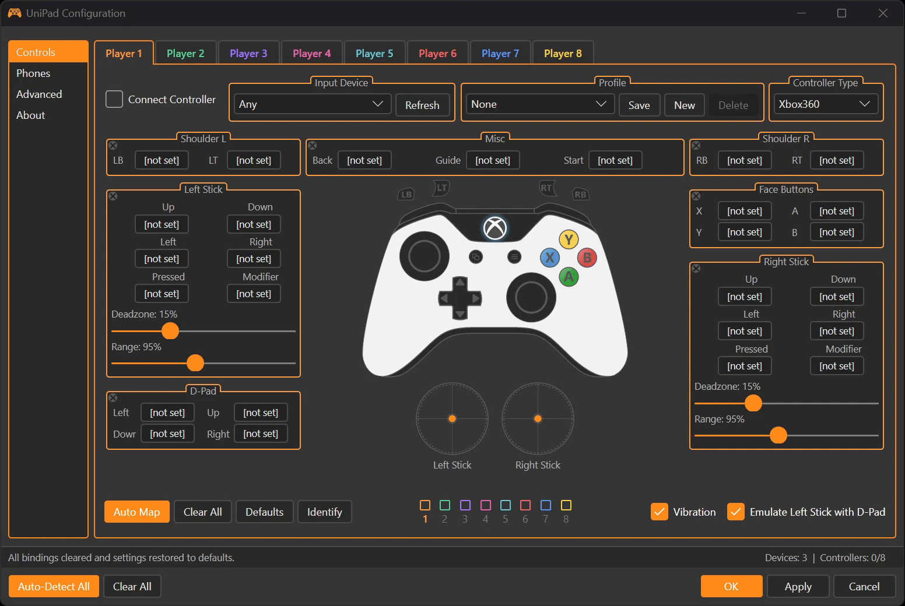
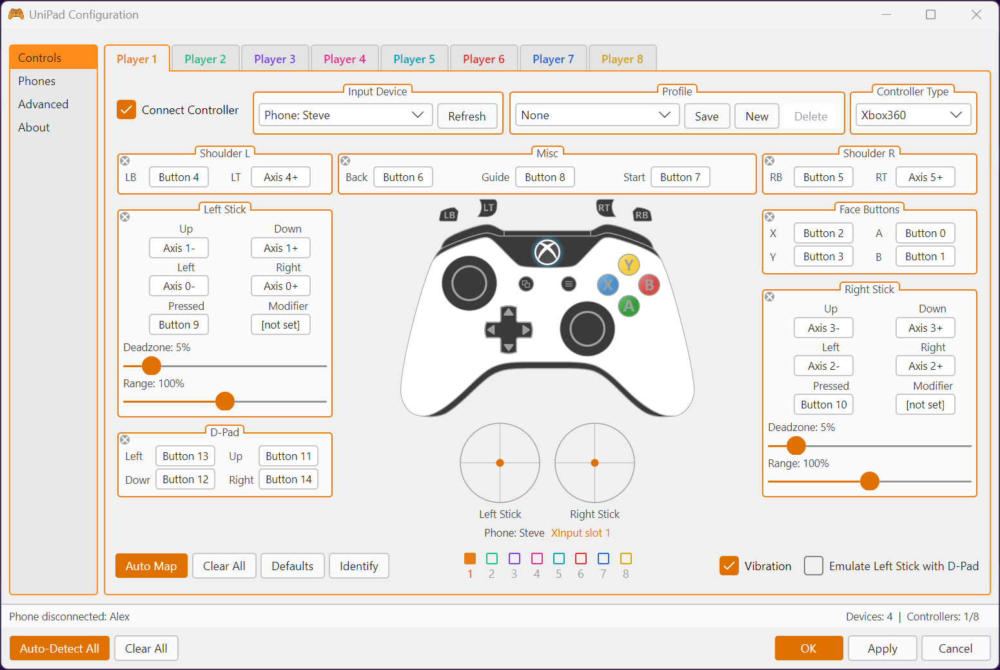
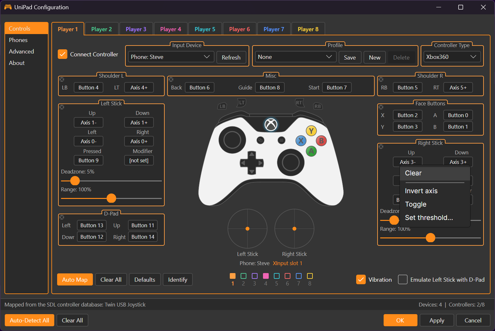
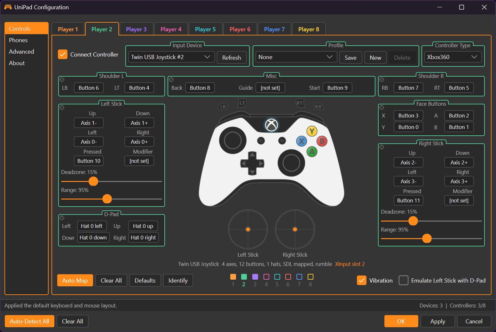
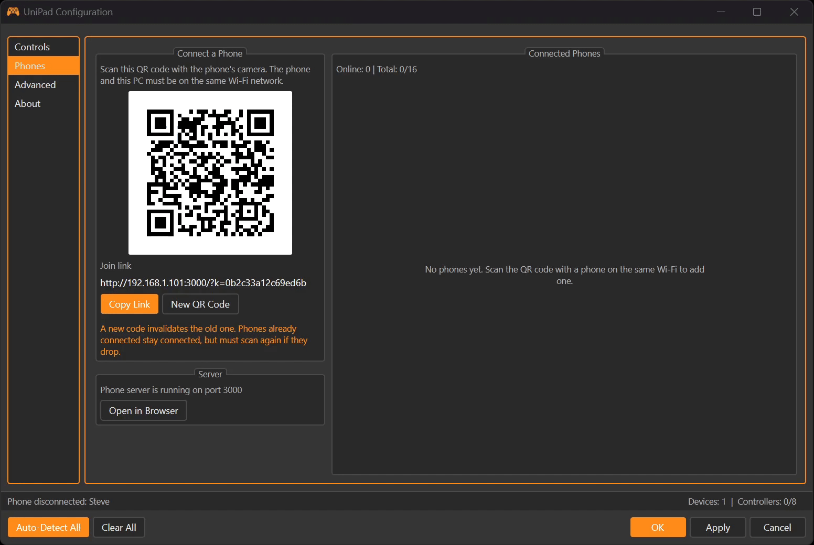
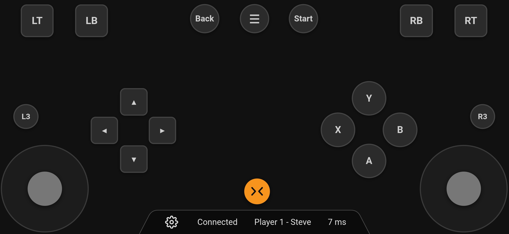
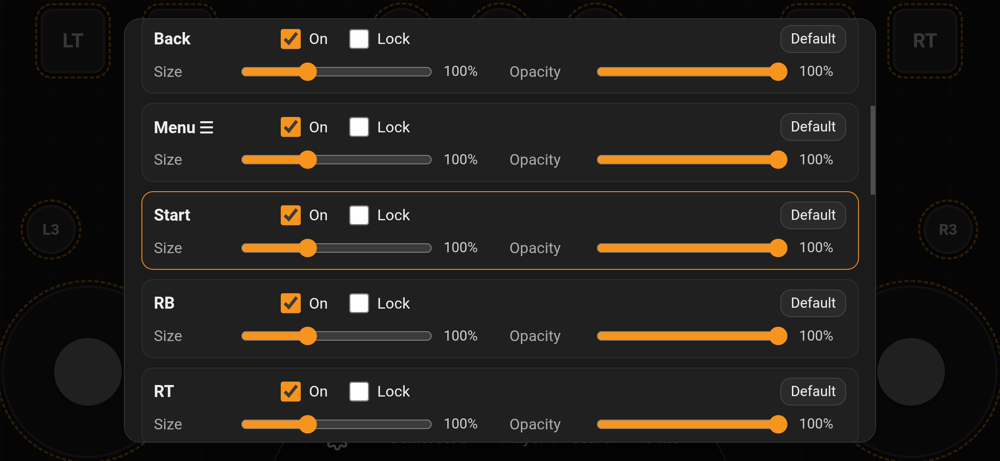
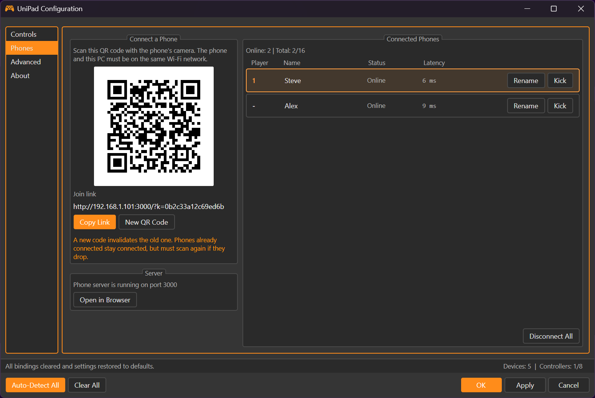
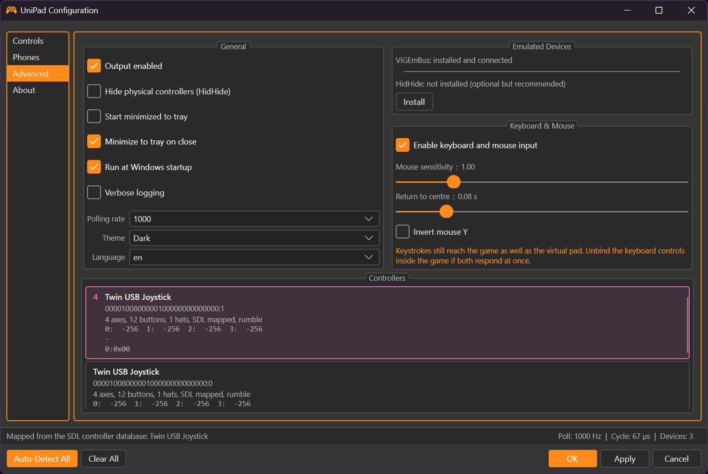

<div align="center">

# UniPad

**Universal Controller Mapper for Windows**

Make *any* controller — or your phone — work with *any* game.

[](../../releases/latest)
[](LICENSE)
[](https://dotnet.microsoft.com/)
[](#)
[](../../releases/latest)


</div>

---

UniPad presents **any** input device — modern gamepads, analogue-less retro pads, arcade sticks,
racing wheels, PS1/PS2/N64/SNES USB adapters, no-name clones, and now **any phone on your Wi-Fi** —
to Windows as a standard **Xbox 360 (XInput)** or **DualShock 4** controller.

If a game only speaks XInput, UniPad makes your hardware speak XInput.

> **New in 1.5.0 —** phones as controllers with a fully customisable on-screen layout, a fixed
> colour for every player, and a clickable player strip.
> See the [release notes](../../releases/latest).

## Watch the demo

<div align="center">

[](https://www.youtube.com/watch?v=Tu7QjqXIcI0)

<em>Click the thumbnail to watch the full walkthrough on YouTube.</em>

</div>

## Contents

- [Quick start](#quick-start-for-regular-users)
- [Do I need to install anything else?](#do-i-need-to-install-anything-else)
- [Features](#features)
- [Usage guide](#usage-guide)
  - [Phones as controllers](#phones-as-controllers)
- [Building from source](#building-from-source)
- [Architecture](#architecture)
- [Troubleshooting](#troubleshooting)
- [Contributing](#contributing)
- [License and credits](#license)

## Quick start (for regular users)

> **You do not need Visual Studio, the .NET SDK, or any programming tools.**

1. Go to **[Releases](../../releases/latest)** and download **`UniPad.exe`**.
2. Double-click it. That is the whole installation — it is a single portable file.
3. On first run a banner may say *ViGEmBus is not installed*. Click **Install** and approve the
   Windows prompt. UniPad downloads and installs it for you.
4. Open a **Player** tab → tick **Connect Controller** → pick your device → click **Auto Map**.
5. Click **Apply**. Verify at [gamepad-tester.com](https://gamepad-tester.com) or by running `joy.cpl`.

<div align="center">
  
  <br>
  <em>One click on <strong>Auto Map</strong> and an unknown pad is fully bound.</em>
</div>

**Using a phone instead?** Open **Phones** in the sidebar, scan the QR code with the phone's
camera, then pick the phone in a player's **Input Device** box. Details in
[Phones as controllers](#phones-as-controllers).

### Do I need to install anything else?

| Component | Needed? | Notes |
|---|---|---|
| .NET runtime | ❌ **No** | The release build is self-contained — the runtime is inside the exe. |
| Visual Studio / SDK | ❌ **No** | Only needed if you want to build from source. |
| **ViGEmBus driver** | ✅ **Yes, once** | Installed automatically by UniPad on first run (one UAC prompt). |
| HidHide | ⚪ Optional | Only to stop "double input". UniPad can install it for you too. |
| An app on the phone | ❌ **No** | The phone controller runs in the phone's browser. |

> **Why can't ViGEmBus be inside the exe?**
> Creating a virtual controller requires a **kernel-mode driver**, and Windows does not allow a
> portable application to fabricate one. Every tool of this kind (DS4Windows, x360ce, reWASD) has
> the same requirement. UniPad at least makes it a single click instead of a scavenger hunt.

## Features

**Input**
- Detects *everything* SDL3 can see: gamepads, joysticks, wheels, arcade sticks, generic HID pads
- Hot-plug: connect or disconnect mid-session, mappings survive and re-attach automatically
- Stable device identity, so a controller returning on a different USB port keeps its bindings
- Handles drifting/noisy analogue axes from cheap adapters via resting-value calibration
- Raw device monitor showing live axis/button/hat values — invaluable for unknown hardware

**Phones** *(new in 1.5.0)*
- Any phone on the same Wi-Fi becomes a full gamepad — scan a QR code, no app to install
- Two analogue sticks, triggers, bumpers, D-Pad, face and system buttons
- Customisable layout: move, resize, lock, disable and fade every control, per control or all at once
- Fullscreen button, vibration toggle and renaming from the phone itself
- Follows the app language (English/Persian) live, including right-to-left
- You choose which player each phone drives — scanning never grabs a slot on its own
- A phone that drops off Wi-Fi returns to the same player when it reconnects

**Mapping**
- **Auto-map** with two paths: the SDL gamepad database, and a heuristic fallback for unknown pads
- **Full manual mapping** — click a bind, press the input, done. Never touch a config file.
- All four conversion scenarios:
  - button → button
  - **button → axis** at full deflection *(this is what makes analogue-less retro pads work)*
  - axis → button (threshold)
  - axis → axis
- **Radial** dead zone (not per-axis), adjustable range, invert, threshold, modifier and toggle
- **Emulate Left Stick with D-Pad** for controllers that have no analogue sticks at all

**Output**
- Virtual **Xbox 360** and **DualShock 4** controllers via ViGEmBus
- **Up to 8 players** for local multiplayer
- Rumble return path from game → virtual pad → your physical controller
- **Identify** button to find out which physical pad is which
- Optional **HidHide** integration to hide physical devices and stop double input

**Application**
- Single portable `.exe` — no installer, no registry mess, nothing left behind
- Portable data folder next to the executable (falls back to `%APPDATA%` on read-only media)
- Profiles with save/load and schema migration
- **A fixed colour per player** across tabs, group frames, the player strip and device lists
- **Clickable player strip** to jump straight to any player's tab
- System tray, minimize-to-tray, run-at-startup
- Dark and light themes, each with its own tuned player palette
- **English and Persian (فارسی)** with full right-to-left layout
- In-app update check
- Configurable 60–2000 Hz polling; reusable device topology and allocation-free steady-state device lookup

<div align="center">
   
   <br>
   <em>Light theme, with the darker player palette tuned for pale surfaces.</em>
</div>

## Usage guide

### The controls at a glance

Everything for one player lives on a single tab, so nothing is hidden behind wizards or dialogs.
The window title bar, the live controller preview in the middle and the stick visualisers at the
bottom all update in real time while you press buttons, which means you can confirm a mapping
without ever launching a game.

| Control | What it does |
|---|---|
| **Auto Map** | Binds the selected device automatically — SDL database first, heuristics as fallback. |
| **Clear All** | Removes every binding for this player only. |
| **Defaults** | Restores dead zone, range and option defaults without touching bindings. |
| **Identify** | Rumbles the selected physical pad so you know which one it is. |
| **Auto-Detect All** | Runs Auto Map for every connected player tab at once. |
| **Vibration** | Enables the rumble return path from the game to your physical pad. |
| **Emulate Left Stick with D-Pad** | Drives the left stick from the D-Pad, for pads with no sticks. |
| **Player strip (1–8)** | Shows which players are live, in their colours. Click a number to open that player. |
| **Apply** | Creates/updates the virtual controllers. Nothing reaches games until you press this. |

The status bar tells you where a mapping came from (for example *Mapped from the SDL controller
database*) plus how many devices are visible and how many of the 8 player slots are in use.

### Mapping an unknown controller

1. **Player** tab → tick **Connect Controller**.
2. Choose your device in **Input Device**. If it is not listed, click **Refresh**.
3. Click **Auto Map** and test. For a known pad this is usually all you need.
4. For anything wrong: click the bind button, then press the physical input within 5 seconds.

### Fixing a single binding — right-click

You never have to redo a whole mapping because one button landed in the wrong place.
**Right-click any bind button** for its own menu:

<div align="center">
  
</div>

| Menu item | Use it when |
|---|---|
| **Clear** | You want to unbind just this one input and leave everything else alone. |
| **Invert axis** | A stick, pedal or trigger reads backwards. Common on racing wheels and cheap adapters. |
| **Toggle** | You want the input to latch on/off instead of being held — handy for sprint or handbrake. |
| **Set threshold…** | An axis is being used as a button and you need to choose how far it must travel to count as a press. |

### Controllers with no analogue sticks

Retro pads (NES/SNES/Mega Drive adapters) have only a D-Pad, so games expecting a stick ignore them.

Tick **Emulate Left Stick with D-Pad**. The D-Pad then drives the left stick at full deflection,
with diagonals normalised to 0.7071 so diagonal movement isn't faster than straight movement.

### Local multiplayer

Add players on tabs 1–8. Set each one's **Input Device** and **Output Mode**.

Every player has a fixed colour. It tints the tab caption, the frames of that player's panel, its
square in the player strip, and the row of the device it uses on the **Advanced** and **Phones**
pages — so with a room full of pads you can see at a glance which device drives which player.

<div align="center">
  
</div>

> ⚠️ **Windows provides only 4 XInput slots.** Players 5–8 must use DualShock 4 output, which
> XInput-only games will not see. UniPad states this on those tabs. This is a Windows limitation,
> not a UniPad one.

### Phones as controllers

Any phone on the same network as the PC can be a controller. Nothing is installed on the phone —
the controller is a web page served by UniPad itself.

<div align="center">
  
</div>

#### Connecting a phone

1. Open **Phones** in the sidebar (or **Phones (QR)** in the tray menu).
2. Scan the QR code with the phone's camera and open the link.
3. The phone joins the device list and shows *waiting for a player*.
4. On a **Player** tab, pick the phone in **Input Device**. The phone layout is bound, the player is
   enabled, and the phone vibrates and shows its player number.

Picking the phone on another player moves it there. A phone that loses Wi-Fi returns to the same
player when it reconnects.

> On first run Windows Firewall asks for network access — allow it on **Private** networks.

#### On the phone

<div align="center">
  
</div>

The bottom bar shows the connection state, the phone's name and player, and the latency. The
orange button switches fullscreen; the gear opens the settings:

| Setting | What it does |
|---|---|
| **Move** | Drag any control to where your thumbs want it. |
| **Size** | Scale one control, or all of them, from 50 % to 200 %. |
| **Opacity** | Fade one control, or all of them, from 10 % to 100 %. |
| **Lock** | Pin a control so it cannot be dragged by accident. |
| **Disable** | Hide a control you do not use, so it never fires. |
| **Reset** | Restore one control, or the whole layout, to the default. |
| **Name** | Rename the phone (up to 20 characters) — the PC sees the new name at once. |
| **Vibration** | Turn the touch vibration on or off. |

Settings are stored on the phone, so each phone keeps its own layout.

<div align="center">
  
</div>

#### The Phones page

The page shows the QR code and the join link with a copy button, the server state, and the LAN
address and port the link uses. If the PC has several network adapters, pick the one your phones
share. It lists every phone with its player (in the player's colour), online state and latency,
and lets you rename or kick a phone, or disconnect them all. **New QR Code** invalidates the old
link. **Open in Browser** shows the same page in a browser on this PC.

<div align="center">
  
</div>

> Safari on iPhone does not support fullscreen or vibration for web pages; everything else works.

### Stopping "double input"

Windows sees both your physical controller *and* the virtual one, so some games register every
input twice. Fix: install **HidHide** (Advanced tab → Install) and tick
**Hide physical controllers**.

### When a pad reports nonsense

Unknown and clone hardware sometimes reports button indices that have nothing to do with the
labels printed on the plastic. The **Advanced** tab has a raw monitor that shows every axis,
button and hat live, so you can press a button, read its real index, and bind it by hand. Devices
in use are framed in their player's colour and lead with the player number.

<div align="center">
  
</div>

## Building from source

Requires the **[.NET 9 SDK](https://dotnet.microsoft.com/download/dotnet/9.0)** on Windows.

```cmd
git clone https://github.com/UniPad-app/UniPad.git
cd UniPad
dotnet build UniPad.sln -c Release
```

To produce the portable single-file executable:

```cmd
build\publish.cmd
```

Output: `build\out\UniPad.exe` (~48 MB, self-contained, compressed).

Cross-compiling the Windows binary from Linux or macOS also works:

```bash
dotnet publish src/UniPad.App/UniPad.App.csproj \
  -c Release -r win-x64 --self-contained true \
  -p:PublishSingleFile=true -p:EnableCompressionInSingleFile=true \
  -p:DebugType=none -o build/out
```

## Architecture

```
UniPad/
├── UniPad.sln
├── Directory.Build.props          net9.0, C# 13, nullable, unsafe blocks
├── build/publish.cmd              single-file release script
└── src/
    ├── UniPad.Core/               all logic, zero UI dependencies
    │   ├── Input/                 SdlInputBackend, DeviceId, InputSnapshot, InputDevice
    │   ├── Mapping/               MappingEngine, AutoMapper, InputBinding, PadState
    │   ├── Output/                ViGEmX360Pad, ViGEmDs4Pad, OutputManager, FeedbackRouter
    │   ├── Network/               PhoneServer, PhoneLayout, Web/controller.html + admin.html
    │   ├── Profiles/              ProfileStore + JSON source-generated context
    │   └── System/                PortablePaths, DriverBootstrapper, HidHideService, LogSetup
    └── UniPad.App/                Avalonia 11 UI
        ├── Views/                 MainWindow, PlayerConfigView, PhonesView, AdvancedView, AboutView
        ├── Views/Controls/        ControllerPreview, AnalogStickPreview, TriggerBar, BindButton
        ├── ViewModels/            MainWindow, PlayerConfig, Phones, Advanced, About, PlayerColors
        ├── Services/              AppState, BindCaptureService, TrayIconHost, StartupRegistration
        ├── Styles/                Palette.axaml, Controls.axaml
        └── Localization/          Strings.cs — English/Persian string table, RTL aware
```

### Design decisions

| Area | Decision |
|---|---|
| Input | SDL3 (`ppy.SDL3-CS`) — joystick + gamepad + events, background-events hint enabled |
| Poll loop | Dedicated thread, absolute deadlines, reusable Windows high-resolution waitable timer; legacy precise-wait fallback on unsupported systems |
| Hot path | Typed device keys, topology snapshots rebuilt only on add/remove, cached rumble callback; capture, feedback and network parsing can still allocate |
| Dead zone | **Radial**: `mag = √(x²+y²)`, then `min((mag−dz)/(1−dz), 1) × range` |
| Axis drift | Resting values captured at open; bind capture needs >50 % travel from a fresh baseline |
| Feedback loop | `ExpectVirtualDevice()` blacklists joysticks appearing within 500 ms of a ViGEm connect |
| XInput order | Pads connected with a 300 ms stagger so Windows assigns slots in player order |
| Phones | Local Kestrel server + WebSocket; state streamed at ~60 Hz and on every change, short taps latched 40 ms, 4 KB message cap |
| UI refresh | 60 Hz dispatcher timer, decoupled from input; diagnostics throttled to ~6 Hz |
| Persistence | `System.Text.Json` **source generator** (trim-safe), portable data folder |

## CPU optimisation and reproducible verification

This working-tree patch is based on **da09c32841de6f0debf09a236117ebe3afa3d92f**
(v1.5.0), addressing [issue #3](https://github.com/UniPad-app/UniPad/issues/3).
No mapping algorithm, saved setting, profile schema, phone protocol, UI, output report
frequency setting, rumble policy or driver feature was removed.

- `Input/PollDeadlineWaiter.cs` releases the CPU using a reusable high-resolution Windows timer.
  Windows 10 1803+ is needed for this path. If the native timer cannot be used, a warning is
  logged once and the legacy precise waiter is retained. The fallback can still consume a core.
- Deadlines compensate ordinary wake-up overshoot, skip missed periods after a stall, and
  reset when the configured rate changes. Windows scheduling jitter is not a hard real-time guarantee.
- Physical device lookups no longer format `DeviceId` strings for each of the 27 mapping targets.
- SDL and phone polling reuse arrays rebuilt only when device/client topology changes.
- Output polling reuses the rumble-strength callback rather than allocating a delegate per cycle.

### Completed verification and limits

Both source versions built successfully. The same hardware-free test executable passed **54
checks** per run, including real SDL virtual joystick input, twin ports, reconnects, runtime rate
changes, real loopback phone WebSockets, stale release, short-tap latching, and phone reconnects.
The deterministic **100,000-frame** mapping replay produced identical checksums. Five separate
Release processes per version were measured in alternating order on Linux/.NET 9, with tiered
compilation disabled for reproducibility. Raw data and methodology are in
[`build/performance/results.json`](build/performance/results.json).

Selected medians (microbenchmarks, **not whole-application CPU percentages**):

| Synthetic operation | Before | Patched | Allocation per operation, before → patched |
|---|---:|---:|---:|
| Evaluate 27 bound targets | 3.670 µs | 1.739 µs | 2376 → 0 bytes |
| Eight fake-pad output cycle, no ViGEm IO | 30.221 µs | 14.091 µs | 19072 → 0 bytes |
| Poll eight phone records, no network parsing | 0.688 µs | 0.347 µs | 144 → 0 bytes |

The original waiter alone consumed approximately 100% of **one core** at 1000/2000 Hz on
this Linux host. This is not a measurement of the full Windows application. The patched
application also cross-published successfully as a self-contained win-x64 single-file executable.
**Native Windows timer performance, full Windows CPU/latency, physical rumble/HidHide and
DS4Windows comparisons have not been run.** No production deployment or upstream push was made.

### Re-run locally

From the source root with the .NET 9 SDK:

```powershell
dotnet run --project tests/UniPad.Performance -c Release -- patched
# Windows only: legacy vs native timer, CPU/core and interval p50/p95/p99 at 60–2000 Hz
dotnet run --project tests/UniPad.Performance -c Release -- --wait
# Any OS: isolated legacy busy-wait at 1000 and 2000 Hz
dotnet run --project tests/UniPad.Performance -c Release -- --legacy-wait
# Whole-process Windows measurements: start/configure each app manually, one at a time.
.\build\performance\Measure-Process.ps1 -TargetProcessId 1234 -Label UniPad-before -Scenario idle-tray
```

The harness accepts `-p:CoreProject=<absolute path to upstream UniPad.Core.csproj>` at build time
so exactly the same tests can run against the original checkout; see
[`build/performance/REVIEW_FA.txt`](build/performance/REVIEW_FA.txt) for complete instructions,
the patch application steps and the hardware release checklist. Before release, run at least
three matched 60-second Windows samples per scenario (idle/active, visible/tray, USB/Bluetooth,
1/4/8 players where supported). Check achieved input/report rate and p99 latency as well as CPU;
a lower CPU number caused by lost polling frequency is not a valid improvement. For DS4Windows,
record its exact distribution/version and use the same supported physical pad, transport, profile,
output type and settings. The PowerShell script measures CPU/memory only; its `PollHz` parameter
records the requested rate and does not measure or change it.

## Troubleshooting

| Problem | Cause / fix |
|---|---|
| *"ViGEmBus is not installed"* won't go away | Restart after installing the driver. If it persists, install [ViGEmBus](https://github.com/nefarius/ViGEmBus/releases) manually. |
| Game registers every input twice | Install HidHide and tick **Hide physical controllers**. |
| Controller not listed | Click **Refresh**. If still missing, check it appears in `joy.cpl`. |
| Game ignores players 5–8 | Windows has only 4 XInput slots; those players emit DS4. Not fixable. |
| Stick drifts on its own | Raise the dead zone on that stick. Cheap adapters often need 0.15–0.25. |
| Buttons map to the wrong thing | Use the Advanced tab's raw monitor to see real indices, then bind manually. |
| Nothing happens in-game | Check **Output enabled** on the Advanced tab, and that the profile was **Applied**. |
| Phone page does not open | Phone and PC must be on the same network (not a guest network). Allow UniPad in Windows Firewall on **Private** networks, and pick the right LAN address on the Phones page. |
| Phone says *waiting for a player* | Expected — pick the phone in a player's **Input Device** box. |
| Phone feels laggy | Check the latency on the Phones page; move closer to the router or use 5 GHz Wi-Fi. |
| Game with anti-cheat rejects it | Kernel-mode anti-cheat may block virtual pads. UniPad does not attempt to bypass it. |

Logs live in the `logs` folder next to `UniPad.exe` (or under `%APPDATA%\UniPad\logs` when the
executable sits on read-only media). Attach the newest log file to any bug report.

### Anti-cheat and privacy

UniPad creates a virtual gamepad through the public ViGEmBus driver and does nothing else to your
system. It does not inject into games, hook processes, or hide itself. Some competitive titles with
kernel-mode anti-cheat block virtual input devices on principle, and that is their decision to
make — UniPad will not try to work around it. Nothing is sent anywhere: there is no telemetry
and no account. The only network activity is the update check, downloading the ViGEmBus/HidHide
installers when you explicitly ask, and the local phone-controller server (address and port shown
on the Phones page), which only accepts phones on your own network that scanned the QR code.

## Contributing

Issues and pull requests are welcome.

**Reporting a bug.** The single most useful thing you can include is the exact controller name as
shown in the **Input Device** dropdown, plus the newest log file. A screenshot of the Advanced
tab's raw monitor while the problem is happening usually settles the question immediately. For
phone issues, include the phone model and browser.

**Adding controller support.** If Auto Map gets a pad wrong, the fix often belongs upstream in
[SDL_GameControllerDB](https://github.com/mdqinc/SDL_GameControllerDB) rather than in UniPad. Open
an issue either way and we can work out which.

**Code.** Keep `UniPad.Core` free of UI dependencies, and keep the polling hot path
allocation-free. New UI strings must be added to both English and Persian — in `Strings.cs` for
the app, and in the `I18N` table of `controller.html` for the phone page.

## License

MIT — see [LICENSE](LICENSE). Full third-party license texts are in
[THIRD-PARTY-NOTICES.md](THIRD-PARTY-NOTICES.md).

### Third-party components

| Project | License |
|---|---|
| [SDL3](https://libsdl.org/) | zlib |
| [ViGEmBus / ViGEm.NET](https://github.com/nefarius/ViGEmBus) — Nefarius Software Solutions | MIT / BSD-3 |
| [HidHide](https://github.com/nefarius/HidHide) — Nefarius Software Solutions | MIT |
| [Avalonia UI](https://avaloniaui.net/) | MIT |
| [Serilog](https://serilog.net/) | Apache-2.0 |
| [CommunityToolkit.Mvvm](https://github.com/CommunityToolkit/dotnet) | MIT |
| [QRCoder](https://github.com/codebude/QRCoder) | MIT |
| [SDL_GameControllerDB](https://github.com/mdqinc/SDL_GameControllerDB) | Zlib |
